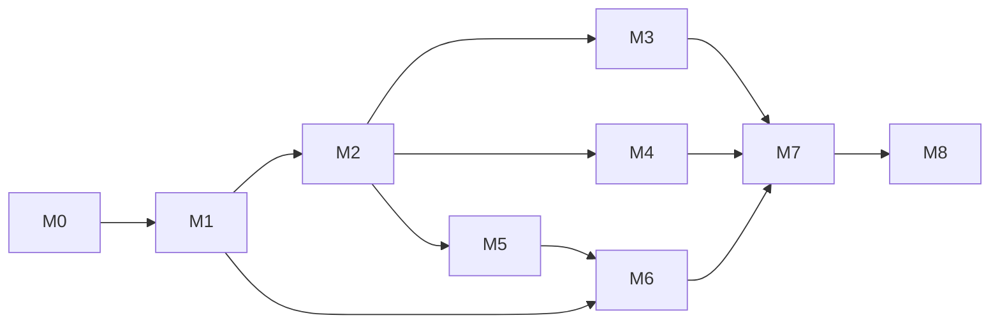

# aq-git implementation specification

**Status:** Draft for review  
**Date:** 2026-10-30  
**Target:** Standalone baseline 0.1  
**Governing design:** [aq-git design specification](../specs/0001-aq-git.md)

Implement a standalone Rust binary with direct CLI execution and an optional persistent Unix-socket interface. The complete repository correctness suite must run with installed Git and temporary local files. No Agent Q process, aq-graph process, database, Docker daemon, cloud account, or network package download is required after build dependencies are available.

This specification defines implementation work; it does not claim that any module or verification already exists. Design requirement IDs R1–R15, acceptance IDs V1–V15 (including V4a), and performance targets P1–P7 refer to the governing design. If implementation exposes an infeasible contract, revise both specifications explicitly before substituting behavior.

## 1. Delivery boundaries

The deliverable is one `aq-git` executable, protocol schema and examples, reusable internal Rust crates, tests, benchmarks, and operations documentation. AQ integration consumes the public process protocol and artifact format. Do not add sibling path dependencies, query AQ databases, copy the v1 train engine, or make the build depend on another AQ checkout.

Ship capability-gated increments. A command whose milestone has not landed must be absent from capabilities and return `unsupported_feature`; a stub cannot report success. The first useful release is a complete local read/workspace/transfer/candidate/publication loop. Hosted AQ wiring is a separate consumer task.

## 2. Toolchain and repository structure

Use Rust edition 2024 and initially pin the same Rust toolchain as the Agent Q foundation, 1.96.1. This is a project compatibility choice, not a requirement to share Cargo workspaces. Commit Cargo.lock. Use installed Git with a baseline feature floor of 2.43 and test both that floor and a current supported patched release. Distribution security updates remain required; a feature floor is not a recommendation to retain an unpatched historical package.

Probe required behavior at startup/registration: SHA-1 support, `cat-file --batch-command`, NUL-safe tree/status/diff outputs, `merge-tree --write-tree`, bundle verification, ref transactions, and explicit expected-value push leases. Do not use version strings as the only capability check. Features beyond the floor must have an explicit fallback with equivalent behavior or remain unsupported.

```text
Cargo.toml
Cargo.lock
rust-toolchain.toml
crates/
  aq-git-protocol/
    src/{lib,ids,requests,responses,errors,capabilities}.rs
    tests/{wire,compatibility}.rs
  aq-git-core/
    src/
      lib.rs
      config.rs
      git/{mod,runner,environment,objects,refs,bundle,merge,push}.rs
      state/{mod,root,journal,atomic_file,recovery,retention}.rs
      repository/{mod,binding,observation,queries,cache}.rs
      workspace/{mod,create,inspect,checkpoint,retire}.rs
      artifact/{mod,manifest,export,import}.rs
      candidate.rs
      publication.rs
      service.rs
      limits.rs
      metrics.rs
    tests/{repository,workspace,artifact,candidate,publication,recovery,limits}.rs
  aq-git-cli/
    src/{main,commands,client,server,output}.rs
    tests/{cli,socket,process_recovery}.rs
tests/
  support/                    shared fixture crate or included test support
  scenarios/                  central and worker process scenarios
protocol/v1/
  schema.json
  examples/
  compatibility/
scripts/{check-fast,check-all,bench,check-docs}
benchmarks/{fixtures,results}/
docs/{api,operations,development,benchmarking,aq-integration}.md
```

The dependency graph is CLI → core → protocol. Protocol depends on serialization/error types, never filesystem or subprocess code. Core owns all domain operations; direct CLI and socket handlers invoke the same `RepositoryService` entry points. The CLI client can depend only on protocol where possible. No stable public Rust ABI is promised; the versioned wire contract is the external integration boundary.

Initial library candidates are serde/serde_json, clap, tokio with explicit process/I/O/sync/net/time features, thiserror, tracing, uuid, sha2, and a small OS-lock/process-control crate. Use tempfile for fixtures and a property-testing crate only for meaningful parser/state-machine properties. Generate JSON Schema with a small schema dependency or a dedicated dev tool; choose one source of schema truth. Do not introduce sqlx, SQLite, a Git reimplementation, HTTP framework, or general workflow engine.

## 3. Internal interfaces and records

### 3.1 Typed boundary

Define validated newtypes for `RepositoryId`, `OperationId`, `WorkspaceId`, `CandidateId`, `TransferId`, `ObservationId`, `RefName`, `ObjectId`, and generations. IDs are opaque UUIDs at the wire boundary, independent of task IDs. `ObjectId` carries `{algorithm, hex}` and validates full length/hex; only `sha1` is enabled in baseline capabilities. `RefName` validates the full namespace separately from publication-target allowlisting.

The core exposes operations conceptually equivalent to:

```rust
pub struct RepositoryService { /* state owner, stores, runner, limits */ }

impl RepositoryService {
    pub async fn execute(&self, request: Request) -> Response;
    pub async fn recover_local_operations(&self) -> RecoveryReport;
    pub async fn shutdown(&self) -> ShutdownReport;
}

pub trait GitRunner {
    async fn run(&self, command: GitCommand) -> Result<GitOutput, GitFailure>;
}
```

These signatures specify responsibility, not a required trait-object mechanism. Keep shell strings out of `GitCommand`: it contains a trusted executable path, argument vector, managed working directory, explicit environment profile, bounded stdin, output limits, deadline, and read/write classification. Fault injection wraps this port while correctness fixtures still run real Git.

Inject a clock and an ID source at the service boundary for deterministic deadlines, timestamps, and crash-replay tests. Production IDs use OS randomness. A request's wire timestamp never sets the server's observation clock.

### 3.2 Durable records

| Record | Required fields |
| --- | --- |
| RootFormat | format version, installation ID, created timestamp |
| OwnerIncarnation | incarnation ID, host boot identity, guard/engine identity evidence, active/clean lifecycle, cleanup evidence or audited fence clearance |
| RepositoryBinding | repository ID, binding generation, local mode, identity, object format, allowed refs/targets, optional remote/profile, local feature profile |
| PoolRecord | repository ID, local storage generation, present/evicting/absent lifecycle, owning eviction/rehydration operation |
| Observation | ID, binding generation, covered refs/map, start/end time, availability, last refresh error |
| OperationRecord | ID, repository ID where applicable, canonical payload hash and payload, kind, phase, generation, allocated resource IDs, fixed commit metadata, timestamps, result/error/evidence |
| WorkspaceRecord | ID, base OID/pin, private path, generation, lifecycle, last checkpoint, allocating/retiring operation IDs |
| TransferRecord | ID, manifest hash, source/base/prerequisites, retained ref, receipt, releasing operation if any |
| CandidateRecord | ID, frozen inputs, merge profile, fixed metadata, per-step results, final OID/tree or conflict, retained refs |
| RetentionRecord | handle ID/generation, owning resource and binding generation, exact refs/OIDs, active/releasing/released lifecycle, live dependency edges, release operation/reason |

Define JSON serialization versions and fixtures for each before implementing mutations. Persist only typed fields with explicit defaults for compatible additions. Canonical operation hashing serializes the validated typed request with stable object-key order, preserved array order, and normalized OIDs/refs. Exclude request ID, transport deadline, and output presentation. Include expected generations and all mutation-affecting fields. An idempotency lookup happens before allocating a new resource or invoking Git.

Reserve operation IDs across the entire state root using `operations/<operation-id>.json`; each record identifies its repository. The same ID cannot execute in a second repository. Test that collision explicitly. Registration expects generation zero. Reconcile/resolve commands have their own operation IDs and point to an existing `target_operation_id` with its expected record generation. Recover the command and target-record update together through recorded local phases, without losing either idempotency outcome.

Record the caller's repository identity/generation in artifacts. A worker registration reproduces the assignment's logical binding generation while using worker mode and no remote credentials. Local filesystem paths, credential profiles, and transport details are installation-local and must never be copied from an artifact. Reject a manifest naming another registered identity/generation.

Separate registration's absence precondition (expected generation zero) from the positive installed generation. Implement `repo binding-update` with design section 5.1's complete replacement input, central +1/worker monotonic adoption rules, immutable identity/mode/object format, and drained transition. Under repository coordination, close admission, drain active readers/children, then check live handles, nonretired workspaces, and other unresolved operations. Return `binding_in_use` with blocker IDs and reopen admission on refusal. Otherwise persist old/new binding intent, archive the old version, install the new binding, invalidate derived state/readers, and finish the operation before reopening admission. Recovery completes this sequence before dispatch. Do not interpret a new assignment or incoming artifact as permission to mutate an existing binding. Terminal replay lookup precedes current-generation validation and is explicitly historical; new effects require the current generation.

## 4. Algorithms and correctness boundaries

### 4.1 Filesystem durability and process ownership

Acquire an OS lock on `owner.lock` before reading state for mutation or running local recovery. A socket server holds it for its entire life. Direct commands hold it through all child cleanup and response persistence. A second process fails with `state_busy`; it does not remove another process's lock file. PID text is diagnostic, never lock authority.

Provide an internal lifecycle guard using the same executable in both direct and service modes. The guard owns the root lock, durably marks an incarnation active before launching the request engine or Git work, and supervises the engine and command descendants. On Linux, use subreaper/process-group supervision with a private lifetime channel and tested descendant tracking; executable helpers permitted by configuration must obey this managed lifecycle. The engine cannot launch commands outside the guard's supervision. Engine exit or channel loss closes admission and triggers TERM/KILL cleanup and reaping; only after the engine and all descendants are gone may the guard persist clean-incarnation evidence and release ownership. PID/PGID reuse and helpers that fork require explicit tests; process groups alone are not proof of complete cleanup.

If the guard is killed, a newly acquired lock still encounters the durable active incarnation. Refuse recovery and mutations with `recovery_blocked` until cleanup is established. A changed host boot identity can establish local process death; otherwise require the documented trusted operator/runtime procedure to stop the old execution environment and use `recovery clear-fence` with the expected incarnation, reason, and cleanup evidence. This is an audited local attestation, not a PID-based automatic repair or a claim about remote effects. The command takes the root lock and journals its own operation before clearing the exact fence; a mismatched incarnation refuses. Read-only diagnostics remain available. No dependency on AQ, systemd, Docker, or delegated cgroups is permitted for the normal guard path.

Test engine-only SIGKILL while a real Git command and a forked helper are paused, then an immediate competing invocation: no replacement mutation may execute before descendant cleanup. Separately kill only the guard and show that surviving descendants cannot overlap replacement recovery because it remains blocked. Cover crashes before launch, during launch handshake, during cleanup, and before the clean marker is durable. Test explicit fence clearance after fixture-controlled termination. Killing the entire test process group is not a substitute for these cases.

Atomic record replacement uses an unpredictable same-directory temporary filename, mode 0600, complete write, file `sync_all`, rename, and parent-directory synchronization. State directories use mode 0700. Creation of new directories and root metadata also needs parent synchronization. Refuse symlink traversal into mutable metadata/artifact paths using directory-relative opens or an equivalent tested approach; string-prefix containment checks alone are insufficient.

Configure managed Git writes with `core.fsync=objects,reference` and `core.fsyncMethod=fsync`, and verify behavior on the supported Git floor. Synchronize relevant metadata/directories where Git's guarantees do not cover a journal acknowledgement. The exact durability adapter and supported filesystem assumptions must be documented. Git's default can leave new loose objects vulnerable to an unclean shutdown; do not use a default assumption for a retention receipt. See [Git durability configuration](https://git-scm.com/docs/git-config#Documentation/git-config.txt-corefsync).

For a retained resource, persist intent → create/harden objects → create/harden the exact retention ref → persist resource record → persist operation terminal result → respond. On restart, inspect existing refs and records for the recorded IDs. Resume missing local steps when inputs match; mismatches become a doctor finding and blocked operation. Never overwrite an unexpected ref to make recovery pass.

No automatic recovery sends a publication that reached `dispatched`. Record and restore its uncertainty before serving target mutations. The internal guard handles local child cleanup even without an AQ runtime. Established local cleanup or fence clearance does not prove a remote request had no effect.

### 4.2 Git command environment

Use an administrator-selected absolute Git executable and an environment allowlist. Set no-prompt behavior, fixed locale, pager disabled, replacement refs disabled, empty/controlled hooks directory, no automatic GC, and explicit Git config overrides. Scrub inherited `GIT_DIR`, index paths, alternate directories, config injection variables, shell aliases, trace destinations, and user-defined Git execution helpers unless a particular operation explicitly sets them.

Credential profiles can expose a known SSH setup or credential helper only to central remote operations. Redact environment values, authenticated URLs, and helper stderr from public errors/logs. Tests use a temporary home and empty global/system configuration, with local file transport enabled only by fixture registration.

Repository content may include arbitrary filenames. Parse NUL-delimited outputs and represent non-UTF-8 paths with an explicit byte encoding plus optional display string. Do not lossily turn distinct paths into the same Unicode value. Never parse human-oriented `git status` or grep stderr to determine a domain result when an exit status or structured format exists.

### 4.3 Synchronization and observations

Fetch configured refs into a unique staging namespace for one synchronization operation. Use a concrete configured ref scope and bounded enumeration; never mirror arbitrary remote refs into local private namespaces. Once Git completes and required objects are available, capture the staged ref map and durably install an observation plus the managed tracking refs. Clean unused staging refs through recorded recovery. A completed observation stores exact OIDs; readers never resolve its names again while answering a query.

Negative ref observations require complete coverage of the requested scope. Empty or partial transport output cannot erase previous facts. Concurrent synchronizations for the same binding/scope share a flight. A stricter caller minimum that the flight cannot meet schedules one subsequent refresh; ordinary consumers accept the completed observation without a new fetch. Publish/failed-refresh events invalidate only mutable observation freshness, not immutable OID-pair caches.

Current-state truth from a remote is always an observation boundary. Tests must update the remote during fetch and demonstrate that candidate construction freezes the returned OIDs instead of claiming a globally atomic multi-ref snapshot.

### 4.4 Queries and cache

Use a bounded `cat-file --batch-command` process pool for commit/object metadata. Lease one process for each framed exchange; consume exact byte lengths and delimiters before returning it. On timeout, malformed output, or child exit, discard the process and fail affected requests without assigning residual output to another request. Metadata and blob-size limits apply before allocating buffers.

Use strict ancestry with `merge-base --is-ancestor` on full validated commits. Exit 0 means true, 1 means false, other exits mean error. Do not memoize a missing object as false. Cache by binding and immutable query key. Use per-key single-flight computation with cancellation behavior that does not strand other waiters. A cache clear changes no retention refs or journals. A maintenance/storage-generation change that can invalidate object availability clears affected caches and restarts Git object readers.

Tree and diff output are bounded and explicitly truncated or paginated. Patch output is an artifact when larger than the response budget; it never becomes a partially successful mutation. Query batches are read-only and may contain independent per-item errors. A full batch cache hit is served without Git or network calls.

### 4.5 Workspace algorithm

For create, persist a workspace ID and temporary path in intent, create a base retention ref in the pool, initialize a private Git repository in the temporary directory, install a runtime-generated alternates file pointing to the pool object directory, set managed config, and check out the exact base detached. Do not inherit a writable remote. Validate checkout feature support before materialization. Finalize the directory and records through the recoverable sequence in section 4.1.

The pool may not prune while workspace alternates borrow it. Workspaces write their own objects and index and read borrowed objects. The worker's baseline harness grants exclude sibling workspaces and direct pool mutation; test those adapter settings separately from OS-level read-only enforcement, which is an optional stronger capability. Do not claim hostile-process isolation from Git alternates. Maintain no live references to another worker's mutable files. A private checkout root must not contain an agent-chosen `.git` symlink or point outside the configured workspace root.

Checkpoint requires stopped writers and matching expected generation/HEAD. In `head` mode require clean porcelain-v2 status including untracked files. In explicit `all` mode use a temporary private index seeded from HEAD, add tracked changes/deletions and nonignored files, create a tree, and use fixed identity/message/time with `commit-tree` if the tree changed. Do not include ignored build artifacts. Update workspace HEAD with an expected-old operation and reconcile its real index to the resulting tree while quiescent; interruption recovery must check which phase completed. Import the source closure into the pool, validate base ancestry, and pin it before returning. Include filenames/modes and no-change behavior in fixtures.

Retirement verifies quiescence, generation, HEAD, clean status, and an exact retained checkpoint. Persist intent, rename the workspace into private trash, persist retirement, then remove the trash tree. Crash recovery must never create a new workspace at that path until the prior identity is resolved. Do not recursively delete an arbitrary request path. Checkpoint/source-handle release is separate from workspace-directory retirement; retirement releases only workspace-owned borrowing protection and its dependency edges.

Implement shared retention records and dependency acquisition in M1; M3 adds workspace/checkpoint integration and public lifecycle handlers. M4/M5 reuse the M1 primitives independently of workspace support. Workspace creation owns a borrow/base handle; checkpoint completion durably pins the new source and moves the workspace's latest-checkpoint dependency only after the successor is safe. Old checkpoint handles remain active. Retirement releases the workspace borrow handle/dependencies, preserving checkpoint handles. Provide `retention inspect` and `retention release` using the design's resource table. A release takes expected handle generation and exact refs/OIDs, persists `releasing` intent, deletes matching refs with expected-old checks, then persists released resource/operation results. Recovery tolerates refs already removed by this recorded release, but fails closed on mismatches or missing refs without matching intent. Keep durable released tombstones and historical receipts; never infer live dependencies from every historical mention of an OID.

Candidate/export/publication/import operations acquire input dependencies before use. Candidates obtain independent durable input/prefix pins before dropping temporary input-handle dependencies; unresolved publications retain their candidate dependency. All changes to dependency edges and pins use journaled phases under repository coordination, preventing release/use races and cycles. A released resource is unusable as an active resource even if objects remain. Replay returns original evidence plus current retention state, without reacquisition. Test checkpoint replacement, candidate source sharing, conflict release, blocked publication release, concurrent export/release, release crash points, and the full central-receipt → workspace-retirement → explicit-handle-release → worker-eviction path.

### 4.6 Artifact algorithm

Export creates a temporary retained advertised ref identifying the exact source because Git bundle creation requires a named positive revision. Supply only explicitly acknowledged prerequisite exclusions; first bootstrap has none. Finish and fsync the bundle, hash it, then atomically publish its manifest/artifact directory. A reference-only no-change artifact is supported and still requires receiver availability. Temporary refs remain until export is terminal or recoverably abandoned.

Import accepts only an artifact handle beneath the staging root. Validate manifest schema/identity/generation, declared and actual byte size, digest, and advertised ref. Verify the bundle in a quarantine repository that can read known prerequisite objects but cannot write to the main pool. Validate object connectivity, source/base type and ancestry, prohibited features, and declared prerequisites. Storage/time/quota limits cover unpacked objects as well as compressed bytes. Then fetch the validated source from quarantine into the pool under a generated transfer ref, harden it, persist the receipt, and acknowledge.

Never accept all advertised refs or copy `.git/config` from an artifact. No import modifies the authoritative remote. Same-ID retries return the recorded receipt; a transfer whose pin exists but whose response was lost is repaired locally. A receipt includes receiver installation ID, repository identity, transfer ID, source OID, retention handle, manifest digest, and acceptance time. The caller retains the source until its receiving receipt is acknowledged.

### 4.7 Candidate algorithm

Persist the ordered inputs, Git version/profile, generated candidate ID, and every commit timestamp before starting. Let the accumulator begin at the base. For each source: skip it if ancestral to the accumulator; fast-forward if the accumulator is ancestral to it; otherwise run `merge-tree --write-tree` and parse its structured result. On a clean merge, create a commit with parents `[accumulator, source]` and the fixed step metadata. Pin each clean prefix before journal advancement. No working tree or project shell hook is required.

On conflict, retain inputs and the clean prefix, record bounded conflicting paths and the step index, and finish the operation with a `conflicted` result. A conflicted merge-tree output is not a candidate to publish. A retry returns the same conflict. Repair and altered membership require a new operation/candidate. If an old implementation's algorithm version differs, serve its recorded result or return an explicit incompatible-resume diagnostic; never silently produce another OID for the same durable intent.

Include a complete repair fixture: checkout the clean prefix, perform and resolve a real merge of the conflicting source, checkpoint a merge commit, verify ancestry of both original inputs, and create a replacement candidate from that resolved commit plus remaining sources. An equivalent file tree without the required parents must not pass the ancestry assertion. No custom repair-agent launcher belongs in aq-git.

### 4.8 Worker repository cache eviction

Implement `repo cache-evict` under exclusive repository mutation access after draining readers and persistent object processes. Require worker mode, expected binding/storage generations, reconstructible-cache designation, and no borrowing workspace, live retention handle, or unresolved operation/import/export. Terminal historical records alone do not retain objects after explicit handle release. Persist intent and `PoolRecord` phase, atomically rename only the managed object pool into generation-specific trash, increment storage generation, invalidate derived state, persist the absent-pool result, and reclaim trash. Never delete journal/binding files or a replacement generation's pool.

Rehydration initializes a fresh pool with the existing binding and new storage generation before importing a newly identified transfer. Historical idempotency replay is not a fresh availability receipt. Test old-receipt replay after eviction, missing-object reads, concurrent create/import versus eviction, crashes around rename/record writes, live-pin refusal, and successful import/reuse. Central-mode pools refuse this operation. Worker code must call this API rather than deleting aq-git paths.

### 4.9 Publication algorithm

Validate central mode, binding generation, configured target, retained candidate, expected old commit, local fast-forward ancestry, and absence of unresolved dispatched operations for the target. Query the remote explicitly for preflight diagnosis, but rely on the expected-old push precondition for the actual write. If the candidate is already at/within the observed target, report `already_present` with the observation; it is not an `applied` event.

Persist `prepared`, then `dispatched`, then invoke Git with explicit source and target and `--force-with-lease=<full-ref>:<expected-oid>`. No automatic retries. Parse `--porcelain` per-ref output and process status together; stderr is diagnostic only. A reported changed-ref success gives `applied`; up-to-date gives `already_present`; a definite server rejection gives `rejected`; a lost connection, killed process, mixed/unparseable outcome, or lost terminal persistence gives `indeterminate`.

The target might become up-to-date between preflight and advertisement. Git can omit that ref update; tests must show that such output never asserts a successful expected-old transition. Do not use an unrelated receipt-ref update to fabricate an atomic target-update proof. Creating remote receipt refs and requiring custom receive hooks are deferred.

Reconciliation fetches the authoritative target and records exact ancestry/current-presence evidence without repeating the push. If current containment is demonstrated, `already_present` resolves the desired present-state question but still does not prove the original invocation caused publication. If it is not demonstrated, keep the target blocked until explicit caller resolution. An operator may abandon or permit a new operation with a reason after stopping old publishers; the record preserves ambiguity. Implement the recovery truth table in section 8 as executable tests.

## 5. CLI, service, and external compatibility

Use clap subcommands matching design section 11. `--state-dir` performs a direct operation under the root lock; `--socket` acts as a thin client. Neither selection implicitly starts a service. AQ starts `serve` explicitly and checks capabilities before submitting work. `serve` uses filesystem-private Unix sockets and removes a stale socket only after acquiring the associated root lock and verifying that the path is its own socket.

The NDJSON transport must bound frames before allocation, reject unsupported versions, correlate out-of-order responses by request ID, and support multiple concurrent requests/connections under the advertised limits. Keep logs on stderr. A client disconnect stops read response work when safe but cannot erase durable mutations. A caller reconnects using operation IDs.

Exit codes: 0 success (including ancestry false and a structured candidate conflict result), 2 invalid input/protocol/configuration, 3 precondition/domain refusal, 4 temporary resource/availability failure, 5 indeterminate mutation requiring reconciliation, 1 unexpected internal failure. JSON error codes remain more precise than exit codes. Human output names the next useful command and preserves explicit unknown states.

Schema and example fixtures must cover every advertised operation, response, and error. CI checks fixtures against the schema and compares CLI/service results. Compatible additive response fields are allowed; mutation inputs reject unknown fields. Unsupported major versions fail before dispatch. Include a client fixture from the previous compatible release once a second release exists. Protocol version, on-disk format, artifact format, and merge semantics version advance independently.

No network authentication is implemented by aq-git. AQ authenticates its own requests and translates them into allowed local operations. A worker-supplied operation name or arbitrary JSON object must never be forwarded directly to the central socket. The AQ integration guide must show explicit field mapping and authorization before import/publication.

## 6. Implementation milestones

Each milestone includes code, public contract changes, focused real-Git tests, and documentation. Keep tests with the component owning the invariant. Run broader suites when a shared boundary changes or before release, not after every unrelated edit.

### M0. Protocol and executable scaffold

**Dependencies:** None.  
**Files:** Workspace manifests; protocol crate; CLI version/capabilities/input/output; schema fixtures; development instructions.

- Define typed IDs/OIDs, envelopes, error/retry categories, and capability names, including binding transitions, retention lifecycle inspection, and recovery fencing.
- Implement CLI help/version/capabilities and strict request decoding with no mutation handlers.
- Add deterministic wire fixtures, unknown-field/version tests, frame-size refusal, and JSON/human exit behavior.
- Establish `check-fast`, `check-all`, and formatting/Clippy commands without AQ or Docker setup.

**Done:** A clean checkout builds one binary and validates the machine contract. Unimplemented operations are explicitly unavailable. Covers R10–R12 and prepares V1/V13.

### M1. Git runner, durable root, and operation journal

**Dependencies:** M0.  
**Files:** `git/runner.rs`, `git/environment.rs`, `state/*`, `limits.rs`, test support.

- Implement the internal lifecycle guard, incarnation fence, owned process groups/descendant tracking, argument/environment validation, output/deadline limits, reaping, and timing instrumentation.
- Implement root locking, format refusal, private paths, atomic durable record replacement, generation checks, and idempotency lookup.
- Implement shared retention-record/dependency/release primitives and crash-safe expected-ref transitions, so M2 binding guards and M3–M5 resource handlers share one lifecycle.
- Add fixture construction of real local Git repositories with no global user config.
- Add subprocess crash failpoints before/after record sync, rename, directory sync, and Git ref creation.
- Add engine-only and guard-only SIGKILL tests with surviving children/helpers, competing startup, and audited fence clearance.

**Done:** Two incarnations cannot mutate one root concurrently, including after parent-only crashes; same-ID replay is deterministic; interrupted local records recover or fail explicitly. Unknown descendant cleanup blocks startup instead of allowing overlapping recovery. Covers R4/R10/R13 and V7/V10/V11.

### M2. Bindings, synchronization, immutable queries, and baseline measurements

**Dependencies:** M1.  
**Files:** `repository/*`, `git/objects.rs`, `git/refs.rs`, protocol query fixtures, initial benchmark driver.

- Register central/worker bindings without implicit network activity.
- Implement drained binding updates, version history, stale-input refusal, worker generation adoption, and crash recovery; later milestones extend blocker tests to their resource types.
- Fetch explicit scopes into staging namespaces and install observations.
- Implement inspect, tree, diff, ancestry, and read-only batches, initially with straightforward Git commands.
- Add persistent object readers, bounded single-flight caches, availability invalidation, and synchronization coalescing.
- Measure command counts and latency before/after optimization; retain raw evidence for comparison.
- Commit the P1–P7 workload manifest and direct/persistent Git baselines before tuning. Use an in-process driver initially; final acceptance includes socket transit after M7.

**Done:** Exact reads never fetch; stale/missing observations are explicit; full warm hits perform no Git work; failed refresh preserves previous observations. Binding transitions are recoverable. Covers R1–R3/R13/R15 and V2/V3/V12/V14.

### M3. Private workspaces and retained checkpoints

**Dependencies:** M2.  
**Files:** `workspace/*`, retention refs, workspace protocol/CLI handlers and tests.

- Implement private Git directories with borrowed-object reads and base retention.
- Implement scoped status, expected-generation/HEAD checks, explicit checkpoint modes, source import/pinning, and safe retirement.
- Integrate workspace/checkpoint handles with M1 retention primitives; expose inspection/release and released-state replay. Other resource milestones reuse the same core independently.
- Implement interrupted allocation/checkpoint/retirement recovery.
- Document quiescence and actual confinement assumptions, including the worker's cooperative harness-configured baseline, and verify unsupported checkout features are refused.

**Done:** Independent workspaces edit the same filename safely, retain all supported file modes, and survive service restart. Retirement never deletes dirty/unretained work; checkpoint handles remain explicitly releasable after retirement. Covers R7/R14 and V4/V10/V11/V15.

### M4. Base and source handoff artifacts

**Dependencies:** M2; workspace end-to-end scenario also uses M3.  
**Files:** `artifact/*`, `git/bundle.rs`, artifact schema/fixtures, two-root scenario.

- Implement full and incremental export with named source refs, fixed manifests, digests, limits, and reference-only transfers.
- Implement quarantine import, prerequisite/connectivity checks, pin-before-receipt durability, and idempotent acknowledgement.
- Build a standalone fake AQ transport that copies completed artifacts between independent process roots; no shared writable repository directory.
- Test replay, missing prerequisites, corrupted/truncated/oversized bundles, wrong repository generation, and disconnect before/after acknowledgement.
- Test transfer release, use/release races, historical replay after release, and binding-update refusal while a transfer remains active.

**Done:** A worker can disappear after the central receipt and the central system still has the submitted source. Covers R8–R10/R14 and V5/V6/V7/V11.

### M5. Frozen candidates and conflict reporting

**Dependencies:** M2; M4 supplies integration fixtures.  
**Files:** `candidate.rs`, `git/merge.rs`, candidate protocol/CLI handlers and fixtures.

- Implement deterministic ordered merge steps, no-op/fast-forward handling, retained prefixes, and conflict results.
- Test rename, binary, symlink, executable-bit, and directory/file conflicts against plain Git's supported semantics.
- Verify later source-ref movement and new task completions cannot alter a recorded candidate.
- Add replay/crash tests across each merge step and final receipt.
- Acquire independent candidate input/prefix pins and test source-handle release, shared inputs, conflicted-candidate release, and publication dependencies.

**Done:** The same operation replays the same candidate or conflict; changed inputs need a new operation. Covers R6 and V8/V10.

### M6. Conditional publication and reconciliation

**Dependencies:** M1/M2/M5.  
**Files:** `publication.rs`, `git/push.rs`, operation reconciliation/resolution, process recovery fixtures.

- Implement central-only publication and destination serialization with unresolved-operation holds.
- Implement explicit expected-old leases plus independent fast-forward validation.
- Record dispatched intent before the remote call and classify changed-ref, up-to-date, definite rejection, and unknown outcomes.
- Implement read-only remote reconciliation and audited abandon/permit-new-operation resolution.
- Inject lost output after a real successful local-remote push; also inject races and remote rewrites.

**Done:** All publication truth-table cases pass; no uncertain operation is automatically re-pushed. Covers R1/R4/R5/R13 and V7/V9/V10/V11.

### M7. Persistent service and worker/central integration contract

**Dependencies:** M0–M6; framing/client work can develop after M0/M1 with fake core handlers.  
**Files:** CLI client/server, shared dispatcher, `docs/api.md`, `docs/aq-integration.md`, executable example driver.

- Serve the same domain operations over a private socket with admission limits and request correlation.
- Add direct-CLI versus service parity fixtures, reconnect/replay behavior, and shutdown ownership tests.
- Reserve read admission/progress independently of heavy-operation slots and validate P1/P4/P5 over the real socket, including a stalled fetch.
- Document worker polling, artifact staging, central receipt acknowledgement, stale-attempt handling, and separate published-state reporting.
- Provide a fake coordinator/worker scenario that exercises every outbound conceptual exchange without implementing an AQ scheduler.

**Done:** A process consumer needs no Rust linkage or private file access; no inbound worker connection is required. Covers R9/R12 and V1/V5/V6/V13.

### M8. Operational hardening and release evidence

**Dependencies:** M0–M7.  
**Files:** doctor/maintenance, benchmark fixtures, scripts, CI workflows, operations/release docs.

- Complete retention lifecycle verification, guarded worker `repo cache-evict` and rehydration, safe repack/index maintenance, log bounds, and restore checks. Advertise object pruning as unsupported until its full proof is implemented.
- Run the full crash, concurrency, compatibility, and resource-limit suites.
- Publish P1–P7 evidence against equivalent Git baselines, including the agent decision loop, mixed-load isolation, resource churn, missed targets, and explanations.
- Build versioned binaries with protocol/artifact/state/Git requirements and immutable checksums. Document candidate installation, rollback constraints, and previous compatible client checks.

**Done:** All V1–V15 evidence (including V4a) is linked in a release checklist, and P1–P7 pass or have an explicit governing-spec revision supported by measurements. Deployed AQ integration remains separately identified and cannot be claimed from the fake coordinator test.

### Milestone dependency graph



M3, M4, and candidate development can proceed independently after M2's contracts stabilize. They share versioned interfaces and test fixtures, not direct edits to each other's private metadata. No concurrent agent execution is prescribed by this document.

## 7. Test organization and cost control

### 7.1 Fixture rules

Each integration test creates a private temporary root, separate local bare remote, deterministic commit identities/timestamps, and a scrubbed environment. Tests never discover developer repositories or use real credential helpers. Use filesystem paths/local Git transport; no TCP Git server is needed. Tests involving concurrency use synchronization barriers or failpoint notifications rather than timing sleeps.

Small DAG fixtures have tens of commits and cover semantic combinations. Large fixtures belong to benchmarks. Build one shared fixture builder; do not duplicate entire histories for trivial parser assertions. Only copy/reuse immutable fixture seeds, and give each test isolated writable state.

Use real Git for repository invariants. A fake runner is appropriate for protocol decoding, output limits, spawn failures, and deterministic lost-response injection, but cannot replace tests that establish actual Git behavior. Hooks controlled by fixtures may pause or reject a local test remote; product code never installs user-provided hooks.

### 7.2 Suites and commands

| Suite | Intended command | Contents | Initial elapsed-time budget |
| --- | --- | --- | --- |
| Fast | `scripts/check-fast` | Protocol/core unit tests and small real-Git invariants | <=30 s excluding compilation |
| Complete correctness | `scripts/check-all` | Fast plus process crashes, local sockets, transfer and publication races | <=120 s excluding compilation |
| Static | `cargo fmt --check` and strict Clippy | Formatting, lint, schema/example/docs consistency | Report separately |
| Performance | `scripts/bench --profile reference` | Declared large fixtures, warm/cold, concurrency, stress | Separate explicit run |
| Consumer contract | documented fixture command | Previous-compatible client and fake AQ coordinator | Small, no sibling checkout |
| Hosted compatibility | explicit operator/CI opt-in | Actual HTTPS/SSH remote and chosen host policy | Separate credentials and disposable repo |

These are acceptance budgets to validate on a named development/CI machine, not existing measurements. If a correctness suite exceeds its budget, profile it, move scale-only checks to performance, and preserve semantic coverage. Do not hide necessary failure cases behind manual-only tests just to meet a time target.

Crate-level focused tests are the normal development loop. Changes to shared protocol, runner, or durability code trigger the full correctness suite. An AQ-only code change does not trigger this entire suite; its adapter tests use released aq-git artifacts and the published contract. Release runs all required component checks.

## 8. Mandatory failure and recovery matrix

| Case | Required result |
| --- | --- |
| Crash before intent is durable | No acknowledged operation; retry may create it normally |
| Crash after intent, before a local side effect | Resume with identical IDs and payload |
| Engine killed while Git/helper descendants survive | Guard retains ownership through termination/reaping; competing mutation cannot begin |
| Guard killed, lock becomes available, cleanup unknown | `recovery_blocked`; no replay/mutation until local cleanup is established or audited fence clearance completes |
| Binding update with live resources or unresolved publication | `binding_in_use` with blocker IDs; no release, relabeling, or generation change |
| Crash during drained binding transition | Finish the recorded generation change before admission; old observations remain unusable |
| Worker adopts newer generation or receives stale artifact | Adopt only by explicit drained update; stale artifact/new mutation refuses; terminal replay remains historical |
| Retention ref exists, receipt absent | Verify exact ref, finish local receipt, do not duplicate |
| Ref exists with another OID | Refuse recovery; retain evidence; doctor names mismatch |
| Object write not hardened | No retention acknowledgement; recovery checks connectivity/durability |
| Client disconnect after local completion | Same operation returns the durable original result |
| Same ID with changed source/order/target | `idempotency_conflict`, no Git write |
| Remote ref changes after candidate creation | Candidate remains intact; publication checks new situation separately |
| Remote moves after publication preflight | Expected-old write refuses, or explicit up-to-date handling applies |
| Git says ref is up-to-date | `already_present` observation, never invented `applied` transition |
| Push definitively rejected | `rejected`; candidate and reason retained |
| Push succeeded, response/journal outcome lost | `indeterminate`; reconcile current presence; no automatic second push |
| Remote still at old revision after timeout | Remains ambiguous; no claim that the first request never applied |
| Remote force-push removes prior candidate | Current containment false/unknown; historical ack unchanged |
| Remote unavailable during reconciliation | Preserve pending state and retry advice; do not infer absence |
| Worker disappears before handoff receipt | Source may be only local; AQ must not claim durable central availability |
| Worker disappears after central receipt | Central candidate can be built without the worker |
| Stale assignment uploads valid Git objects | Objects may be retained; AQ separately rejects/accepts attempt result |
| Import missing prerequisite | `prerequisite_missing`; no success receipt; request fuller artifact |
| Malformed/oversized bundle or unsafe ref/path | Bounded rejection in quarantine; target refs unchanged |
| Cache deleted | Recompute same facts; no task/source/publication mutation |
| Worker repository pool evicted | Bindings/history survive; exact reads report unavailable until new transfer rehydrates objects |
| Eviction while workspace/pin/operation uses pool | Refuse without deleting bytes or weakening retention |
| Old receipt replay after pool eviction | Historical result remains historical; no claim of renewed retention or current availability |
| Release while a live dependent/export exists | `retention_in_use` with blocker IDs; dependent's objects remain protected |
| Crash during retention release | Resume exact expected-ref removals and released tombstone; never remove a replacement/mismatched pin |
| Release a candidate after a completed publication | Allowed once live dependencies end; historical publication record remains, without retaining the candidate indefinitely |
| Workspace dirty or writer not stopped | Retirement refused; files preserved |
| Caller exceeds queue/process/frame limits | Bounded `overloaded`/`limit_exceeded`; no unbounded allocation |
| State format newer than binary | Refuse before any migration or Git mutation |

SIGKILL tests exercise process-crash ordering, not power-loss durability. Use injected fsync/rename failures for error handling, and a separate VM/filesystem crash rehearsal before making host-power-loss durability claims. Document which evidence supports each claim.

## 9. Benchmarks and performance decisions

Implement counters in the runner/service first so optimizations can be evaluated. Publish a baseline using straightforward Git processes, then persistent `cat-file`, single-flight, and query caching with identical answers and fixtures. Do not switch Git backends solely on a microbenchmark without conformance coverage.

Design section 14 is the numerical source of truth for P1–P7. Implement one workload driver with adapters for direct installed Git, optimized persistent/batched Git, and aq-git's public socket protocol. Validate equivalent decoded answers before comparing performance. Keep input keys/options and synchronization schedules identical; do not add per-read fetches or formatting subprocesses to the baseline. The 10x p95/5x throughput targets compare the repeated workload to process-per-query Git, and reports must label that denominator. An optional existing-AQ adapter has its own results and cannot be inferred from the standalone comparison.

Check in the seeded fixture/workload manifest before optimization, including the 40/40/10/10 read mix, at least 1,000 distinct warm keys, bounded response sizes, cache limits, concurrency, and measurement windows. For each adapter run warm repeat reads, unique misses with warm filesystem caches, cold starts, 100-item batches, controlled sync bursts, the 32-consumer agent loop, mixed heavy work, and a 30-minute churn/overload run. Synchronization barriers prove single-flight counts and stalled-fetch isolation; wall-clock latency belongs only in the performance suite. Warm hits must produce neither Git spawns nor batch-reader exchanges.

Generate history and workspace fixtures independently to avoid confusing graph size with checkout cost. Record seed, creation command, Git/Rust versions, CPU, memory, filesystem, durability config, repo/object/ref counts, content bytes, cache state, and concurrency. Measure preparation separately; a warmed page cache is not a cold-start result.

The reference run uses 1/8/32 clients, single and multiple repositories, repeated and unique query pairs, synchronization with moving refs, and mixed reads plus heavy operations. Report all requests, including errors and timeouts. Use both closed-loop throughput tests and fixed-arrival-rate latency tests timed from intended arrival; reject excess load predictably and show recovery after the burst. P3's 60-second within-capacity run permits no refusals/errors. Repeat measurement runs at least five times, retaining every run and its spread. Count batches and logical items separately and never count failed work toward speedup.

Acceptance requires the design's absolute latency/throughput, comparative speedup, shared-work, mixed-load, miss-overhead, and bounded-resource targets. Report client round-trip and server phase timing separately. Establish named workspace/candidate/transfer/publication fixture budgets before pilot adoption and demonstrate incremental/reference-only handoff without redundant full-history transfer. A missed target blocks the performance acceptance claim and requires implementation improvement or an explicit governing-spec revision with evidence; a narrative explanation alone does not turn a failed target into a pass.

## 10. Release and operational deliverables

Before baseline release, provide:

- A binary usable through direct CLI or local socket with matching semantics.
- Versioned schemas and representative request/response/error/artifact fixtures.
- Capability and Git-feature documentation, including unsupported repository features.
- An operations guide for private paths, credential profiles, durability, backups, restore, indeterminate publication, retention, and maintenance.
- An AQ adapter guide that specifies outbound transfer and the boundary between artifact receipt and task acceptance.
- Fast/full test scripts, an explicit hosted smoke procedure, and raw benchmark evidence.
- A release manifest identifying binary checksum, source revision, protocol/state/artifact/merge-semantics versions, Git compatibility, and supported upgrade/rollback paths.

Upgrades stop admission, drain or classify active operations, stop child processes, and release the state lock. A replacement binary checks the format before touching state. Never roll an older binary onto an unsupported state format. The baseline should avoid irreversible state upgrades; a future migration needs backup and recovery tests. Building containers, registering package repositories, publishing releases, and deploying an AQ adapter are separate actions from implementing the standalone component.

## 11. Requirement traceability

| Requirement | Main milestones | Acceptance evidence |
| --- | --- | --- |
| R1 Authority | M2, M6 | V2, V9, V10 |
| R2 Explicit observations | M2 | V2, V3 |
| R3 Fast shared reads | M2, M8 | V3, V12 |
| R4 Durable operations | M1, M3–M6 | V7, V10 |
| R5 Conditional publication | M6 | V9, V10 |
| R6 Frozen candidates | M5 | V8 |
| R7 Independent workspaces | M3 | V4 |
| R8 Durable handoff | M4 | V5, V6 |
| R9 Outbound workers | M4, M7 | V5, V6, V13 |
| R10 Minimal dependencies | M0–M8 | V1, dependency/build audit |
| R11 Independent tests | All | V1, fast/full timing evidence |
| R12 Public contract | M0, M7, M8 | V13 |
| R13 Explicit uncertainty | M1, M2, M6 | V3, V9, V10, V11 |
| R14 Retention | M1, M3–M6, M8 | V4, V4a, V6, V10 |
| R15 Agent Git performance | M2, M7, M8 | V3, V12; P1–P7 |

Cross-cutting lifecycle evidence: R4/R12/R13 also require V14 for binding transitions; R14 requires V15 for retention dependency/release semantics. M2 introduces binding lifecycle tests and M3–M6 extend their blockers as resources land.

The implementation is ready for AQ adoption when this table points to passing evidence, public interfaces are versioned, and the standalone process demonstration works without AQ. A separate AQ integration change then supplies real enrollment, polling, transport, execution quiescence, and policy checks while preserving this boundary.
